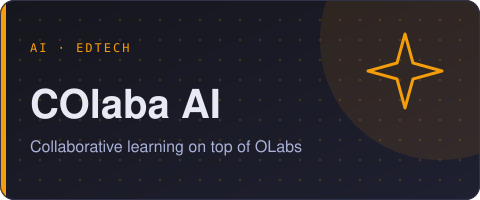
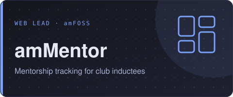
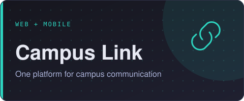
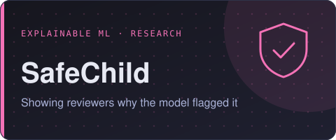
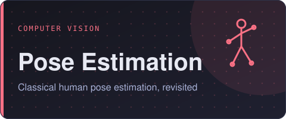

<!-- Header -->

  

  

  
  

---

## 👨‍💻 About me

- 🎓 Final-year Computer Science student
- 👁️ Revisiting **classical human pose estimation**: Flexible Mixtures-of-Parts with adaptive features and pose refinement
- 🌱 Contributor at **amFOSS**, with 97 commits to [amMentor-Web](https://github.com/amfoss/ammentor-web)
- 🏆 Runner-up consolation prize at the Olabs Hackathon with [COlaba](https://github.com/KKSurendran06/COlaba)

## 🛠️ Tech stack

   
   
  

## 🚀 Featured projects

<table>
<tr>
<td width="50%" valign="top">

<b>🏆 Runner-up</b> (top 8 of 30) · OLabs Hackathon · Mar 2025
  
Chrome extension and web portal where students share notes, chat in real time and join video calls, with accessibility features. I integrated the Gemini API to generate summaries and quizzes for learners.
  
<code>Next.js</code> <code>Gemini API</code> <code>Firebase</code> <code>Tailwind CSS</code>
 
 · 
</td>
<td width="50%" valign="top">

<b>Web team lead</b> · amFOSS · Mar 2025 – Feb 2026
  
Platform for tracking inductee progress in the club. I set up the App Router architecture and a shared component library so contributors could build features consistently, and built the mentor dashboard for tasks, submissions and evaluations.
  
<code>Next.js</code> <code>React</code> <code>TypeScript</code>
 
<a href="https://github.com/amfoss/ammentor-web">Code</a> (97 commits)
</td>
</tr>
<tr>
<td width="50%" valign="top">

<b>Frontend</b> · Software Engineering course · Aug – Nov 2025
  
Campus management platform with a web admin portal and a mobile app. I built Next.js admin-portal modules and Flutter mobile UI flows for students and faculty, backed by Supabase.
  
<code>Next.js</code> <code>Flutter</code> <code>Supabase</code> <code>Express</code>
 
<a href="https://github.com/AtharvaNair04/CampusLink">Code</a>
</td>
<td width="50%" valign="top">

<b>📄 Springer LNCS co-author</b> · University research team · May – Jun 2026
  
Multi-label classifier that flags five grooming behaviours in chat text and screenshots, with LIME word-level highlights so human reviewers can check each decision. Deployed through a Docker and Cloud Build pipeline to a Vertex AI endpoint.
  
<code>DistilBERT</code> <code>LIME</code> <code>Tesseract OCR</code> <code>Vertex AI</code>
 
Research project, code not public
</td>
</tr>
<tr>
<td width="50%" valign="top">

<b>Full stack</b> · 2026 · <i>no longer maintained</i>
  
Anonymous whistleblower portal: people submit reports and files without an account, reviewers triage them behind JWT auth and role-based permissions, and every access is written to an audit log.
  
<code>NestJS</code> <code>Prisma</code> <code>React</code> <code>Docker</code>
 
<a href="https://github.com/AtharvaNair04/SecureDrop">Code</a>
</td>
<td width="50%" valign="top">

<b>Computer vision</b> · 2026
  
Extends the classical Flexible Mixtures-of-Parts pose estimator with adaptive features, preprocessing and pose refinement, then benchmarks the changes against the original baseline.
  
<code>MATLAB</code> <code>C++</code>
 
<a href="https://github.com/AtharvaNair04/Computer-Vision">Code</a>
</td>
</tr>
</table>

## 📊 GitHub stats

  

  
  

  

## 🐍 Contribution snake

  <picture>
    <source media="(prefers-color-scheme: dark)" srcset="https://raw.githubusercontent.com/AtharvaNair04/AtharvaNair04/output/github-snake-dark.svg" />
    <source media="(prefers-color-scheme: light)" srcset="https://raw.githubusercontent.com/AtharvaNair04/AtharvaNair04/output/github-snake.svg" />
    
  </picture>

## 🤝 Connect

  

  

