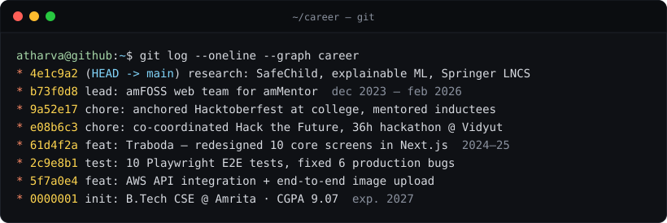
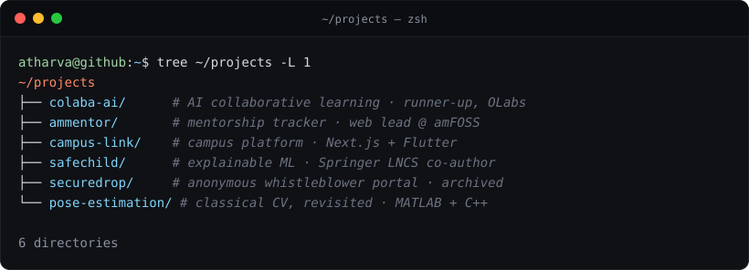
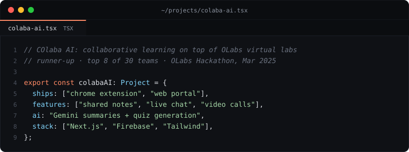
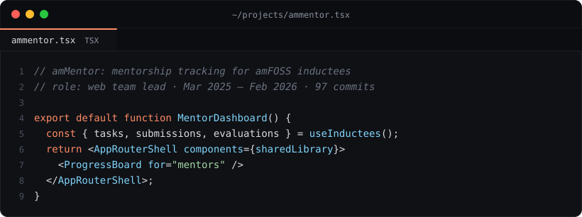
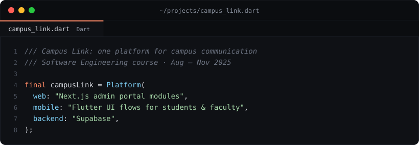
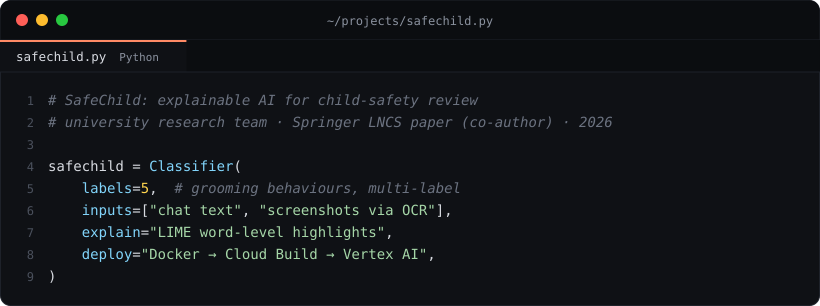
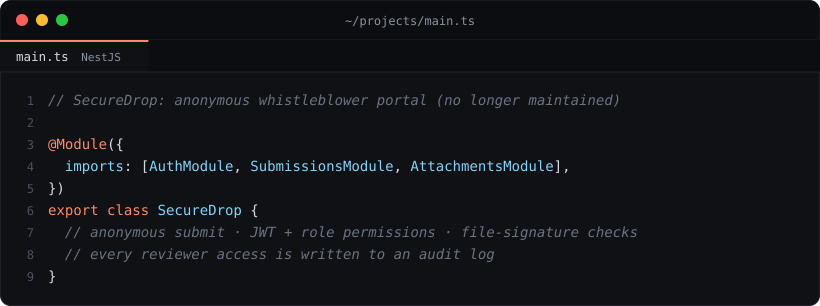
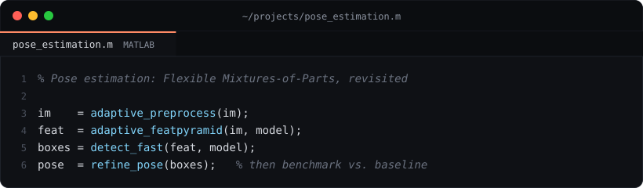
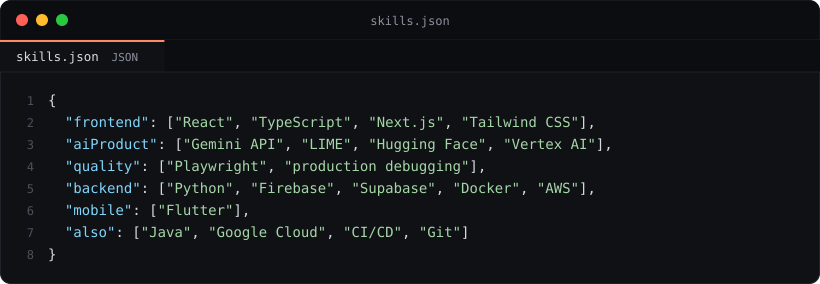

<!-- Visuals in assets/ are generated: edit scripts/build_assets.py and run it. -->

  
  

I build frontends in React, TypeScript and Next.js, from the first prototype to production. I spent a year shipping UI for a cybersecurity SaaS platform, led amFOSS's web team for amMentor, and like building AI features that explain themselves.

### `~/career`

### `~/projects`

<b><code>colaba-ai/</code></b> · AI collaborative learning · <i>runner-up, OLabs Hackathon</i>

 

A Chrome extension and web portal where students share notes, chat in real time and join video calls, with accessibility features. I integrated the Gemini API to generate summaries and quizzes.
→ [code](https://github.com/KKSurendran06/COlaba) · [devfolio](https://devfolio.co/projects/colaba-ai-5397)

<b><code>ammentor/</code></b> · mentorship tracker · <i>web team lead @ amFOSS</i>

 

As web lead I set up the App Router architecture and a shared component library so inductee contributors could build features consistently, and built the mentor dashboard for tasks, submissions and evaluations.
→ [code](https://github.com/amfoss/ammentor-web) (97 commits)

<b><code>campus-link/</code></b> · campus platform · <i>Next.js + Flutter</i>

 

Built Next.js admin-portal modules and Flutter mobile UI flows for students and faculty, backed by Supabase.
→ [code](https://github.com/AtharvaNair04/CampusLink)

<b><code>safechild/</code></b> · explainable ML · <i>Springer LNCS co-author</i>

 

A multi-label classifier that flags five grooming behaviours in chat text and screenshots, with LIME word-level highlights so human reviewers can check each decision. Deployed through Docker and Cloud Build to a Vertex AI endpoint.
→ research project, code not public

<b><code>securedrop/</code></b> · anonymous whistleblower portal · <i>no longer maintained</i>

 

People submit reports and files without an account; reviewers triage them behind JWT auth and role-based permissions, and every access is written to an audit log.
→ [code](https://github.com/AtharvaNair04/SecureDrop)

<b><code>pose-estimation/</code></b> · classical CV, revisited · <i>MATLAB + C++</i>

 

Extends the Flexible Mixtures-of-Parts pose estimator with adaptive features, preprocessing and pose refinement, then benchmarks the changes against the original baseline.
→ [code](https://github.com/AtharvaNair04/Computer-Vision)

### `~/skills.json`

### `~/activity`

`exit 0` · drawn by <a href="scripts/build_assets.py">scripts/build_assets.py</a>
